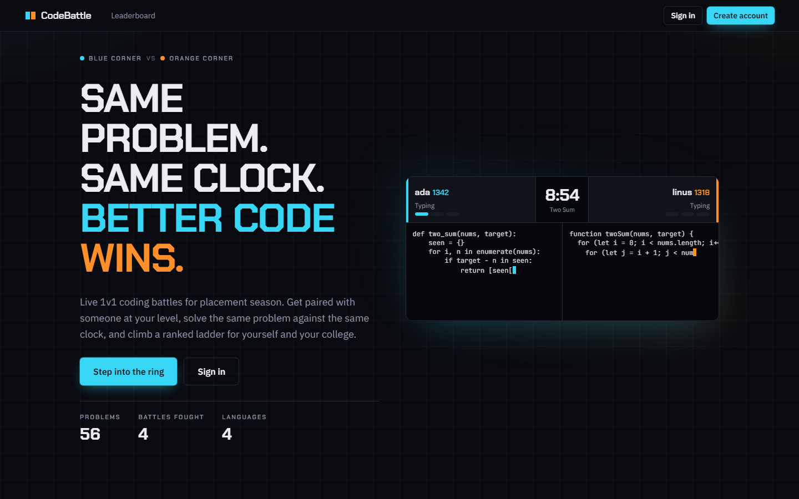
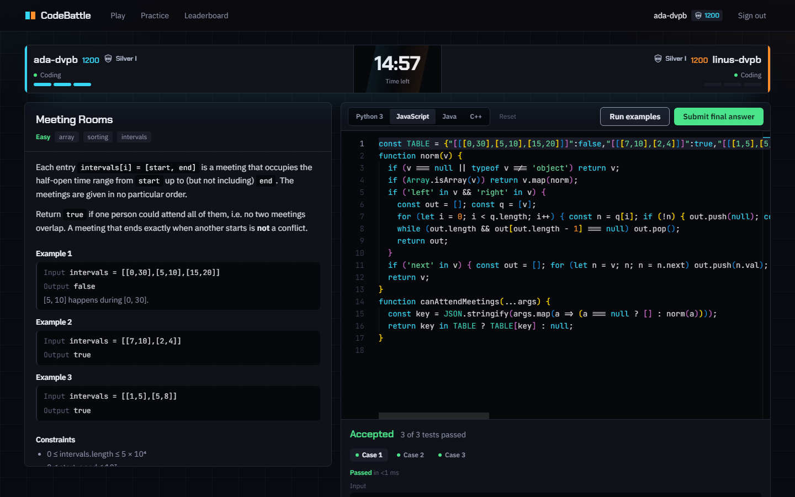
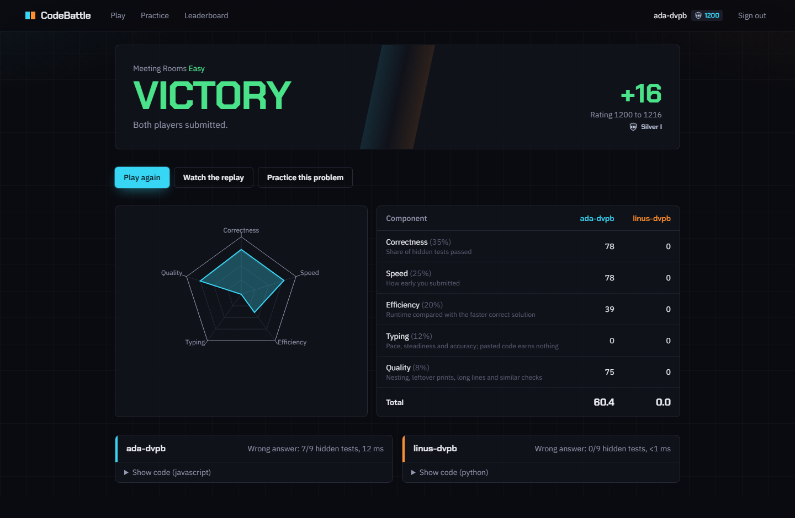
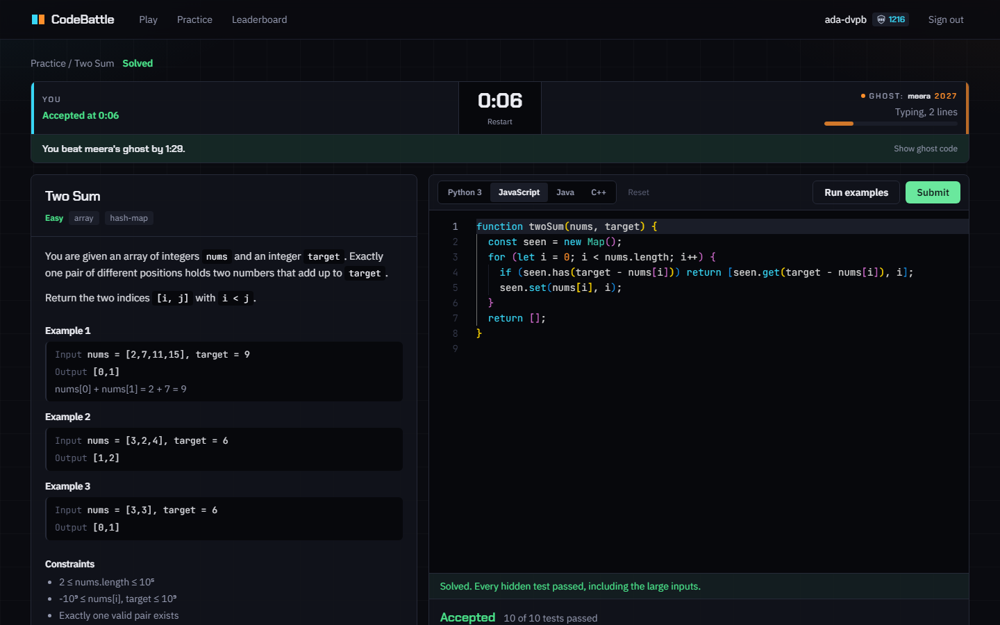
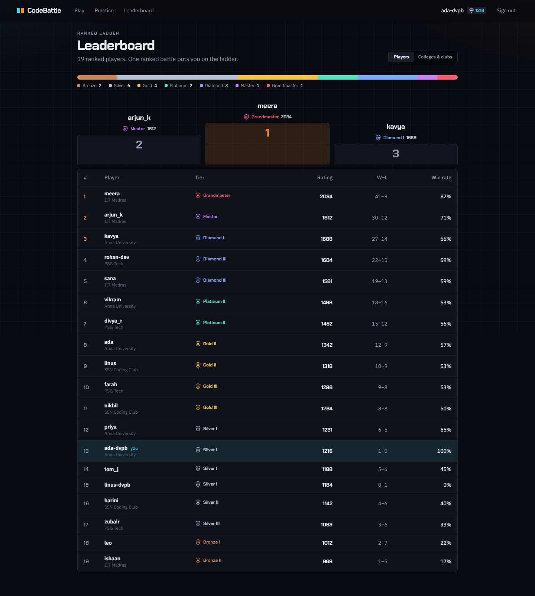
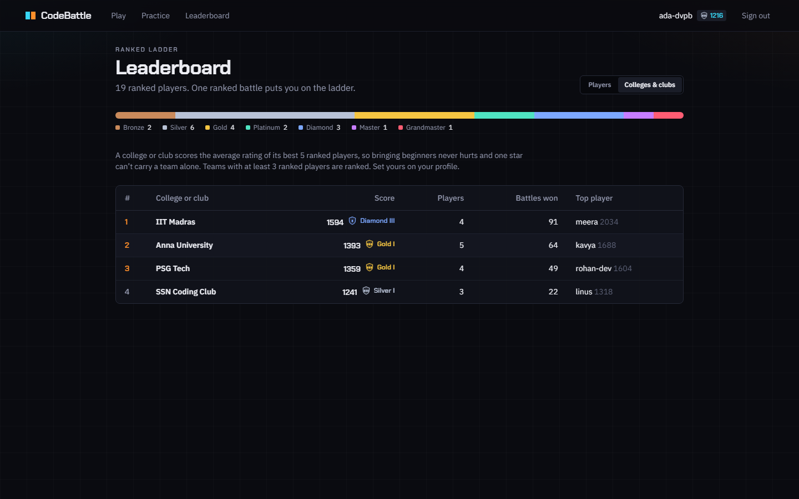
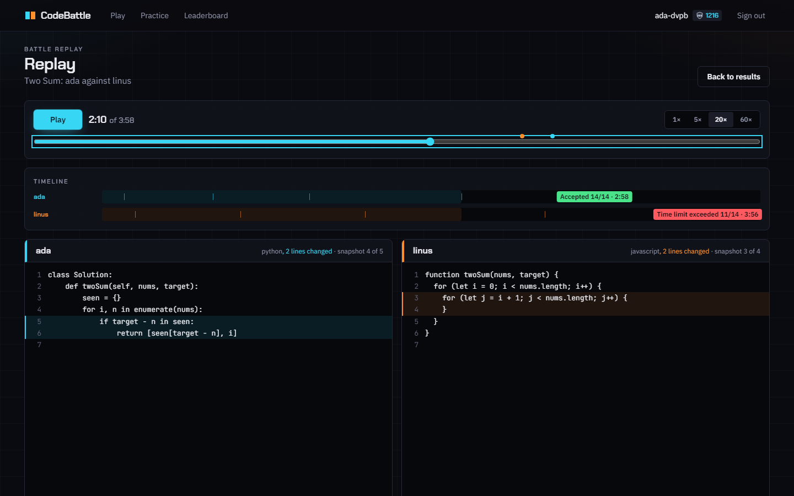
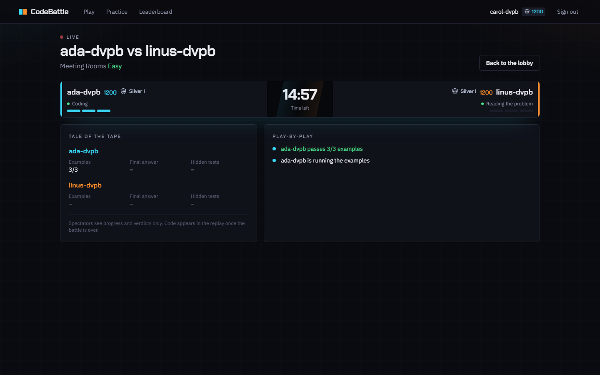
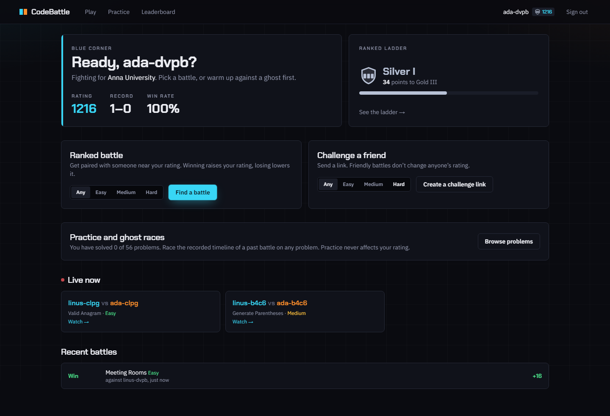
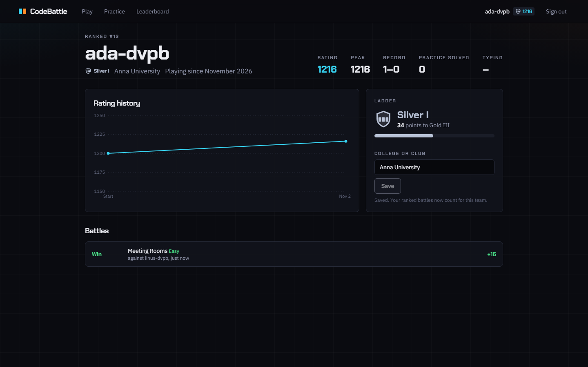

# CodeBattle

[](https://github.com/MrNK2107/CodeBattle/actions/workflows/ci.yml)

**Fight night for code.** Live 1v1 coding battles for students preparing for placements and the coding clubs that train them. Two players near the same rating get the same problem and the same clock. Hidden tests decide who got it right; speed, efficiency, typing and code quality decide who got it right *better*. Both ratings move, and so does your college.



| Battle | Results | Ghost race |
| --- | --- | --- |
|  |  |  |
| **Ranked ladder** | **Colleges and clubs** | **Replay** |
|  |  |  |
| **Spectator view** | **Lobby** | **Profile** |
|  |  |  |

Product brief (audience, positioning against LeetCode contests, Codeforces and CodinGame, brand): [docs/PRODUCT.md](docs/PRODUCT.md). A five-minute demo script: [DEMO.md](DEMO.md).

## Features

- **Ranked battles.** Matchmaking pairs players within ±100 rating. The window widens every 15 s and opens to anyone after 45 s. Python, JavaScript, Java and C++, with LeetCode-style `class Solution` signatures.
- **Ranked ladder.** Elo ratings map to seven tiers, Bronze, Silver, Gold, Platinum, Diamond, Master and Grandmaster, with divisions III, II and I below Master. Everyone starts at 1200 (Silver I, 50 points from Gold). The lobby and profile show your division and the points to the next one; the results page announces promotions; the leaderboard shows the tier distribution and a podium. (`apps/web/lib/ladder.ts`)
- **College and club leaderboard.** Set your college or club at sign-up or on your profile. A college scores the average rating of its best five ranked players, so beginners never hurt it and one star can't carry it; it is ranked once it has three ranked players and listed as "forming" before that. Spelling variants (`IIT  Madras`, `iit madras`, `IIT (Madras)`) group under one slug. Click a college to filter the player leaderboard to its members. (`apps/web/lib/colleges.ts`, `PUT /api/me/college`)
- **Ghost races.** Every battle records each player's code about every 10 s. In practice, race the recorded timeline of a past battle on the same problem, fastest accepted first: the ghost's code grows on your clock, and you see when it submitted and what it got. Beat it to an accepted answer to win the race. The ghost's code stays hidden until the race is decided, and no ghosts are offered while you are battling on that problem. (`apps/web/lib/ghost.ts`)
- **Replays with changes highlighted.** Scrub through any finished battle with both players' code side by side. Lines added or edited since the previous snapshot are highlighted, and a verdict timeline shows every snapshot and each final submission (click it to jump there). (`apps/web/lib/lineDiff.ts`)
- **Spectator mode.** Watch any live battle at `/battle/<id>/watch` (the lobby lists what is live now): both corners' state, examples passing, final verdicts with hidden-test counts, the clock, sudden death and a play-by-play feed. Spectators sit in a separate `watch:<matchId>` socket room and only receive what the server sends there on purpose: no code, no test data, no run output. Code appears in the replay after the battle. (`apps/server/src/socket/spectate.ts`, `apps/web/lib/spectate.ts`)
- **Friendly battles** by challenge link (no rating change), **untimed practice** on all 56 problems, and **profiles** with a rating chart, record, peak rating, typing speed and practice progress.

## How a battle works

1. **Ready.** Both players must open the battle within 60 s, or it is cancelled without rating changes. The clock starts when both are in: 15, 25 or 40 minutes for easy, medium or hard.
2. **Run.** "Run examples" judges the visible tests and shows each case's input, expected output, your output, printed output and errors with line numbers. Your opponent sees how many examples you pass, never your code.
3. **Submit.** Each player gets one final submission, judged on the hidden tests. When a player fully solves the problem, the opponent's clock drops to at most 5 minutes (sudden death).
4. **Score.** The match ends when both have submitted or time runs out. A player without a submission scores 0. Forfeiting loses immediately.

Refreshing or reconnecting mid-battle is safe. Code drafts are kept per battle and language, and the server re-sends the battle state.

### Scoring

`total = 0.35·correctness + 0.25·speed + 0.20·efficiency + 0.12·typing + 0.08·quality`. Each component runs from 0 to 100.

| Component | How it is measured |
| --- | --- |
| Correctness | Share of hidden tests passed |
| Speed | 100 at the start, falling linearly to 0 at the end of the match |
| Efficiency | Time spent inside your function across the hidden tests, compared with the faster fully correct solution (Python is normalized ×4). Within 25% counts as a tie, and each doubling costs 25 points |
| Typing | Pace over active typing time, steadiness and accuracy. Timestamps are re-anchored to the server clock, and pasted code scales the score down |
| Quality | Static checks: nesting depth, leftover debug prints, very long lines or solutions, swallowed exceptions, `eval` |

Every component except correctness is multiplied by the share of hidden tests passed. A fast, tidy, wrong answer therefore scores nothing.

## Architecture

```
apps/web          Next.js 14 (App Router), NextAuth v4, Tailwind, Monaco, Recharts, Socket.io client;
                  ladder, colleges, ghosts and replay diff are pure modules in apps/web/lib
apps/server       Express + Socket.io (/battle), match state machine, judging queue (Bull or in-memory)
packages/shared   socket event contracts, Zod schemas, problem model (signatures, comparison, starter code)
packages/problems the question bank: 56 problems with reference solutions and generated stress tests
prisma/           PostgreSQL schema, migrations, idempotent seed from the question bank, demo seed
```

**Problems are typed.** Each one declares a function signature (`twoSum(nums: int[], target: int) -> int[]`) and how answers are compared:
- **exact:** floats are compared within 1e-6.
- **unordered:** the order of the outer list doesn't matter.
- **unordered-nested:** the order of inner lists doesn't matter either.
- **`$oneOf`:** for problems with several valid answers.

Supported types: ints, doubles, booleans, strings, arrays and matrices of them, character grids, linked lists and binary trees.

**The harness** (`apps/server/src/services/harness.ts`) wraps the player's code in a driver for each language. The driver reads every test from stdin in one run and calls the player's function; LeetCode-style `class Solution` code works too (C++ uses `class Solution` with `vector<int>&`, `ListNode*` and so on, compiled with `g++ -O2 -std=gnu++17`). It captures what the player prints for each test separately, and reports each result with its in-function runtime. Errors point at the player's own line numbers.

**Runners** (`CODE_RUNNER`):

| Runner | Use it for | Notes |
| --- | --- | --- |
| `docker` | self-hosting (compose default) | One throwaway container per run: no network, read-only root, 384 MB memory, 1 CPU, 128 processes, unprivileged user, all capabilities dropped. Set `DOCKER_RUNTIME=runsc` for gVisor. |
| `judge0` | hosted judging | Self-hosted Judge0 or RapidAPI. Language ids are configurable. |
| `local` | development only | Child processes with your own permissions. **Not a sandbox.** Refused when `NODE_ENV=production` unless `ALLOW_UNSAFE_LOCAL_RUNNER=1`. |

**C++ stack.** C++ programs get a 256 MB stack (`CPP_STACK_LIMIT_KB`, default `262144`) instead of the OS default of 8 MB, so a recursive DFS about 10^6 frames deep works as it would on LeetCode. The local runner raises `ulimit -s` before starting the program (or as far as the hard limit allows, 64 MB on macOS); Windows builds link the size in with `-Wl,--stack`; the docker runner passes `--ulimit stack=` (the stack still counts against the 384 MB memory cap); Judge0 gets `stack_limit`, capped at `JUDGE0_MAX_STACK_LIMIT_KB` (default `128000`, Judge0's own default `MAX_STACK_LIMIT`; raise both together). `docker-compose.yml` sets both to `262144` from the one `JUDGE0_MAX_STACK_LIMIT_KB` variable, so the bundled Judge0 gives C++ the full 256 MB. If you point `JUDGE0_URL` at another Judge0, set `JUDGE0_MAX_STACK_LIMIT_KB` to that server's `MAX_STACK_LIMIT`. A program that still overflows gets a runtime error.

**Durability.** Match deadlines live in the database. With Redis, the ready timeout and the match deadline are Bull delayed jobs (`match-timers` queue), so they fire even if the server restarts in between; with `REDIS_URL=memory` they are in-process timers that the server re-arms on boot. A fired timer re-checks the match, so a stale job is a no-op. Submissions left pending by a restart are re-queued. A submission whose judging fails is withdrawn, so the player can submit again instead of losing to an outage. Every state transition is a conditional update, so racing events (two judgements, a forfeit during scoring, a timer firing) apply exactly once.

> The battle server is designed to run as **one instance**: socket rooms, the matchmaking queue and timers are in-process. Scale judging with `JUDGE_CONCURRENCY` or a faster runner, not more servers.

## Run it with Docker

```bash
cp .env.example .env    # set NEXTAUTH_SECRET and POSTGRES_PASSWORD (and PUBLIC_* URLs when deploying)
docker compose up -d --build
```

`NEXTAUTH_SECRET` and `POSTGRES_PASSWORD` are required and have no defaults; compose refuses to start without them. Generate each with `node -e "console.log(require('crypto').randomBytes(32).toString('base64'))"`. The web and server containers get the database as `PGHOST` / `PGUSER` / `PGPASSWORD` / `PGDATABASE`, and their entrypoints build `DATABASE_URL` from those (`scripts/database-url.mjs`, password URL-encoded), so no connection string with a password lives in the compose file. Postgres only reads `POSTGRES_PASSWORD` when its volume is first created; to change it later, run `ALTER ROLE` or drop the `postgres_data` volume.

Open http://localhost:3000 and create an account. The server applies migrations and seeds the question bank on start. It also pulls the three runner images (`python:3.12-slim`, `node:20-slim`, `eclipse-temurin:21-jdk`).

The `docker` runner reaches the host daemon through the mounted Docker socket. Access to that socket is root-equivalent on the host, so on shared machines use Judge0 instead: `docker compose --profile judge0 up -d` with `CODE_RUNNER=judge0`.

For production, put the web app (port 3000) and the battle server (port 4000, WebSockets) behind HTTPS. Set `PUBLIC_WEB_URL` and `PUBLIC_SOCKET_URL` to those public URLs before building, because the socket URL is compiled into the web bundle.

## Run it locally without Docker

Postgres comes from `embedded-postgres`, Redis is replaced by an in-memory mock, and code runs as local `python` / `node` / `javac` / `g++` processes. Java needs a JDK and C++ needs `g++` on your PATH (`CXX_BIN` overrides it). The docker runner uses `gcc:13` (`DOCKER_IMAGE_CPP`), Judge0 language id 54 (`JUDGE0_CPP_ID`, flags in `JUDGE0_CPP_COMPILER_OPTIONS`).

```bash
npm install
npm run build -w @codebattle/shared

npm run db:local          # terminal 1: Postgres on :54329
npm run db:local:setup    # once: migrate + seed (re-run after editing the question bank)
npm run db:local:demo     # optional: demo players, colleges and recorded battles (for ghosts and replays)
npm run dev:server:local  # terminal 2: battle server on :4000
npm run dev:web:local     # terminal 3: web on :3000
```

The first `db:local` (or any `*:local` command) generates a random Postgres password and `NEXTAUTH_SECRET` and stores them in `.local-db/credentials.json` (gitignored); later runs read them back, and the scripts print the database URL with the password masked. A `.local-pg` cluster created before this keeps its data: `db:local` replaces the old fixed password with the generated one on its next start. Delete both `.local-db/` and `.local-pg/` to start from scratch.

Sign in with **Local dev login** and any username. Open a second browser profile with another username, press **Find a battle** in both, and they land in the same battle. `scripts/with-local-env.mjs` sets the local values (from `.local-db/credentials.json`), and `CODE_RUNNER` / `REDIS_URL` / `NEXTAUTH_URL` / `PORT` can be overridden from the shell.

`LOCAL_PG_PORT`, `PORT`, `NEXTAUTH_URL` and `NEXT_PUBLIC_SOCKET_URL` move everything to other ports if 3000/4000/54329 are taken. The demo seed refuses to run with `NODE_ENV=production`.

## Deploying

The production build passes with `npm run build` (Turborepo: shared, problems, server, then `next build`; peak about 2.2 GB). Two processes and two backing services:

| Piece | Runs | Needs |
| --- | --- | --- |
| Web (`apps/web`, port 3000) | `next start` (or `apps/web/Dockerfile`) | `DATABASE_URL`, `NEXTAUTH_SECRET`, `NEXTAUTH_URL`, `NEXT_PUBLIC_SOCKET_URL` (at build time) |
| Battle server (`apps/server`, port 4000, WebSockets) | `node dist/index.js` (or `apps/server/Dockerfile`, which migrates and seeds on start) | `DATABASE_URL`, `NEXTAUTH_SECRET`, `REDIS_URL`, `WEB_ORIGIN`, `CODE_RUNNER` (+ `JUDGE0_URL` / `JUDGE0_API_KEY` for Judge0) |
| PostgreSQL 14+ | managed or compose | `prisma migrate deploy` before the first start |
| Redis 6+ | managed or compose | Bull queues for judging and match timers |

Checklist:
1. Generate `NEXTAUTH_SECRET` once and give the **same** value to web and server (the server verifies the socket tokens the web app mints).
2. Set `NEXT_PUBLIC_SOCKET_URL` before building the web app: it is compiled into the bundle.
3. Put both behind HTTPS; set `WEB_ORIGIN` on the server to the web origin(s), comma-separated.
4. Pick a sandboxed runner: `judge0` (hosted or self-hosted) or `docker` (needs the Docker socket, root-equivalent). `local` is refused in production.
5. Leave `DEV_LOGIN` unset (it is ignored when `NODE_ENV=production` anyway). Optional OAuth: `GITHUB_*`, `GOOGLE_*`.

Every variable, with defaults, is in [.env.example](.env.example).

## Tests

| Command | What it checks |
| --- | --- |
| `npm run typecheck` | All workspaces |
| `npm test` | Web: spectator state and play-by-play, the ladder (tiers, divisions, promotions), college ranking and name grouping, the college API (auth, validation, rate limit), ghost timelines and race outcomes, the ghost race UI, replay line diffs, run results and reconnects. Question bank: every expected value checked against its reference solution, and stress tests deterministic (170 tests). Server: spectator mode (separate room, no code, late joiners, lifecycle events, rate limit), scoring, match rules, typing, quality, the judge in all four languages, match timers (including a deadline surviving a restart; set `REDIS_TEST_URL` to also run it against real Redis), the match lifecycle and battle judging against an in-memory stand-in for the database (finalize, sudden death, forfeit races, judge outages), the Judge0 request and docker flags, and every problem's signature compiled and run in every language. C++ tests use `g++`, or `g++` inside WSL on Windows, and skip without either; they include a 10^6-deep recursion that must pass with the raised stack and overflow without it |
| `DOCKER_TESTS=1 npx vitest run src/__tests__/docker-runner.test.ts` (in `apps/server`) | Sandbox: judging in containers, no network, read-only filesystem, time limits, fork bombs, maximum-size submissions, the C++ stack limit |
| `npm run smoke:battle` | Two bots against a running server: matchmaking, ready, run, opponent progress, practice, one-submission rule, scoring, Elo, replay. `SMOKE_BOB_IDLE=1` with a short `MATCH_DURATION_SECONDS` checks the clock ending a match |
| `node scripts/with-local-env.mjs node scripts/ui-e2e.mjs` | Two headless browsers play a full battle through the UI while a third watches as a spectator (and must never see code), set a college, check the college leaderboard, and (with `npm run db:local:demo` loaded) win a ghost race and open a demo replay. Refreshes `docs/screenshots/*` (`WEB_URL` defaults to :3000) |

## Fair play

- Hidden tests never reach a client before or during a battle. Practice is locked for any problem you are currently battling on.
- The harness reads the tests and captures the clock and output channel before the player's code loads. Result lines are built by the driver and checked by the judge: a duplicate, unknown or negative result fails the run.
- Only Docker itself can signal a judge outage. The player's program runs under a wrapper, so it can't fake one to get a second submission.
- **Socket event rate limits.** Every battle socket event takes a token from two buckets, one for the socket and one for the user (shared across tabs). The check runs before any database read. Each event class has its own bucket, and the defaults sit far above what the web client sends:

  | Class | Events | Per socket (burst, refill) | Per user |
  | --- | --- | --- | --- |
  | telemetry | `battle:typing`, `battle:snapshot` | 20, 5/s (`SOCKET_TELEMETRY_BURST`, `SOCKET_TELEMETRY_PER_SEC`) | x`SOCKET_USER_LIMIT_FACTOR` (2) |
  | action | `battle:run`, `battle:submit` | 5, 0.5/s (`SOCKET_ACTION_BURST`, `SOCKET_ACTION_PER_SEC`) | x2 |
  | control | `battle:ready`, `battle:forfeit` | 10, 1/s (`SOCKET_CONTROL_BURST`, `SOCKET_CONTROL_PER_SEC`) | x2 |

  A rejected event gets a `RATE_LIMITED` error, at most one per second per class. After `SOCKET_MAX_VIOLATIONS` rejections (default 20) within `SOCKET_VIOLATION_WINDOW_MS` (default 60000) the socket is disconnected. The battle room then shows a Reconnect button, and the next page that needs the socket reopens it. `SOCKET_RATE_LIMIT=off` turns all of this off. Judging also has its own limit: one run at a time per player and `RUNS_PER_MINUTE` (20).

## Known limitations

- **One battle-server instance.** Scale judging with `JUDGE_CONCURRENCY` or a faster runner.
- **Python timing can be tampered with.** Runtimes are measured inside the player's process. Python's introspection lets a determined player tamper with that measurement, which is worth up to 20% (efficiency). JavaScript and Java are hardened against it.
- **Typing telemetry comes from the browser.** Timestamps are re-anchored and impossible bursts dropped, but a modified client could still fake it (12% of the score).
- **Email addresses aren't verified.** Usernames are what opponents see.
- **Colleges are self-declared.** Anyone can type any college name; verified institutional emails are on the roadmap.
- **Ghosts move in snapshots.** A ghost replays the code saved about every 10 s during its battle, not individual keystrokes, and battles from before recording began have no ghost.
- **Spectators need an account** and can watch every live battle; there is no private-battle flag yet. A spectator could relay what they see (progress, not code) to a player.
- **Tiers are cosmetic.** Matchmaking uses the rating, not the tier, and there are no seasons or rating decay yet.

## Adding a problem

Add an entry to a file in `packages/problems/src/bank/`. Each entry needs:
- a description and constraints
- a signature
- at least 3 examples and 5 hidden tests
- optional stress generators
- a JS reference solution

`npm test -w @codebattle/problems` checks every expected value against the reference. Run `npm run db:local:setup` (or restart the compose server) to load it.
